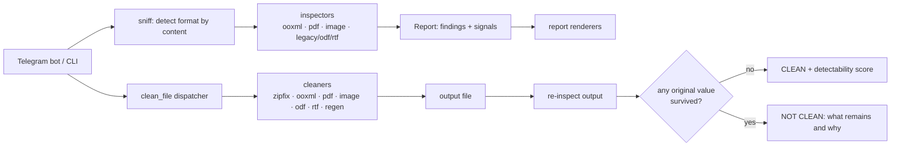

# tgbot_metadata

[](https://github.com/gosha003/tgbot_metadata/actions/workflows/tests.yml)


A Telegram bot and command-line tool that **finds and removes hidden metadata** from documents,
spreadsheets, presentations, PDFs and photos, and then **proves the result** by inspecting the
cleaned file again.

Office files and PDFs quietly carry far more than an author name: the printer's network name, the
path of the template on someone's disk, e-mail addresses of everyone who edited the file, earlier
versions of PDF pages with text under "redaction" boxes, GPS coordinates of photos, the real save time
hidden in ZIP timestamps. This project maps where that data lives in each format, shows it to you,
and removes it without leaving the file looking tampered with.

> **Just want to use the bot?** Step-by-step setup for Windows, macOS and Linux, no programming
> required: **[docs/GUIDE.md](docs/GUIDE.md)** ([на русском](docs/GUIDE.ru.md)).

## Highlights

- **The inspector is the cleaner's oracle.** Cleaning is not "the cleaner says it's done". Every
  cleaned file is re-inspected, and the verdict is *clean* only if **no original sensitive value
  appears anywhere in the output**, compared by value, with short values matched on word
  boundaries so a liar cleaner can't slip through.
- **Invisible cleaning.** Empty metadata is itself a sign of processing, so the default `stealth`
  profile normalizes fields to what a stock application writes instead of blanking them. A
  detectability score (`core/lint.py`) tells you whether the result still looks processed, and the
  report says so plainly when a format makes invisibility impossible.
- **Byte-exact edits.** `core/zipfix.py` rewrites only the parts of a docx/xlsx/pptx/ODF package that
  changed and copies everything else as raw compressed bytes: entry order, DOS timestamps,
  compression levels and Office's local extra fields are preserved, so a Word file still looks like
  Word wrote it. XML is patched in place rather than re-serialized; JPEGs are cleaned without
  re-encoding.
- **Forensics most tools miss.** Printer names, paper size and print-server UNC paths from the
  `DEVMODE` structure in `printerSettings*.bin`; incremental PDF revisions; ZIP timestamps that
  betray library-generated files; font-based dating (Aptos means 2023 or later); reviewer names in
  legacy `.doc` revision tables; contradictions between metadata fields.
- **Built for hostile input.** Zip bombs, path traversal, PDF name-tree DAG bombs, forged ZIP
  end-of-central-directory records, truncated and malformed files. Inspectors never raise, inspection
  is strictly read-only (checked with sha256 before and after), and there are no required external
  binaries.
- **Private by design.** The bot serves only its owner, shows found values under spoilers, deletes its
  reports on a timer, never logs file names or contents, and defuses external links before handing a
  file to LibreOffice (which would otherwise fetch them and reveal your IP).
- **Bilingual.** The bot replies in Russian by default and in English on request (`/lang`). A test
  runs every fixture in both languages and requires identical verdicts: the language can change
  the wording, never the result.

## Supported formats

| Format | Inspect | Clean | Examples of what is found |
|---|---|---|---|
| docx / xlsx / pptx | ✓ | ✓ in place | author, last editor, editing time, Purview labels with e-mail and tenant GUID, template path, printer name and print server, pivot-cache `refreshedBy`, database connection strings, ZIP timestamps |
| PDF | ✓ | ✓ | `/Info`, XMP incl. document IDs and edit history, XMP of individual pages and images, trailer `/ID`, incremental updates, annotation authors, attachments, JavaScript, signatures, hidden layers, EXIF of embedded JPEGs |
| JPEG / PNG / WebP / GIF | ✓ | ✓ (no re-encoding) | EXIF with GPS, camera and lens serial numbers, MakerNote, XMP, IPTC, C2PA, edited-out thumbnail |
| TIFF / HEIF | ✓ | refused on purpose | same as above |
| ODF (odt / ods / odp) | ✓ | ✓ in place | `meta:generator` build, editing duration, template path, printer, comments, embedded images |
| RTF | ✓ | ✓ in place | author, company, revision table, absolute paths, `\*\rsidtbl` |
| Legacy doc / xls / ppt | ✓ | via LibreOffice (`regenerate`) | SummaryInformation, editing time, revision authors, residual text of earlier versions, macros |
| ZIP of documents | ✓ | ✓ batch mode | every file inside, cleaned and proven individually |

## Quick start

```bash
python -m venv .venv                     # Python 3.11+
source .venv/bin/activate                # Windows: .venv\Scripts\activate
pip install -r requirements.txt
```

Inspect a file (read-only):

```bash
python -m core.inspect report.docx       # --json for machine-readable output
```

Clean it into a new file (the original is never modified):

```bash
python -m core.clean report.docx --profile stealth
python -m core.clean scan.pdf --profile paranoid
python -m core.clean old.doc --profile regenerate   # needs LibreOffice
```

Run the bot: put your token from [@BotFather](https://t.me/BotFather) and your Telegram user id into
`.env` (see [.env.example](.env.example)), then

```bash
python bot.py
```

On Windows, set `PYTHONIOENCODING=utf-8` once per console so it doesn't mangle non-ASCII output:
`$env:PYTHONIOENCODING="utf-8"` in PowerShell, `set PYTHONIOENCODING=utf-8` in cmd. The
`PYTHONIOENCODING=utf-8 python ...` prefix used below is for POSIX shells and Git Bash.

### Cleaning profiles

| Profile | What it does | Trade-off |
|---|---|---|
| `stealth` (default) | removes identity and environment, keeps the true application and version, normalizes fields to a stock-application look | for docx/xlsx/pptx two empty identity fields remain a detectable trace; the report says so |
| `paranoid` | removes everything, including application and dates | guaranteed clean, visibly processed |
| `regenerate` | re-saves the file through LibreOffice with a throwaway profile, then cleans the result | no cleaning trace, but the application becomes LibreOffice and layout may shift |

## How it works



Findings fall into four risk categories (identity, environment, provenance, structural) and are
complemented by *signals*: what produced the file, signs of library or AI generation, signs of
earlier scrubbing, inconsistencies, active content. See [docs/ARCHITECTURE.md](docs/ARCHITECTURE.md)
for the contract between inspectors and cleaners and [docs/METADATA.md](docs/METADATA.md) for the
per-format reference of where metadata hides.

## Project layout

```
bot.py                  Telegram bot (aiogram 3): owner-only access, reports, cleaning buttons, batch mode
config.py               settings from the environment or .env (any encoding)
core/
  model.py, sniff.py    shared contract: Risk / Finding / Signal / Report, format detection
  inspect.py            inspection dispatcher + CLI, recursion into embedded files
  insp_ooxml.py         docx / xlsx / pptx inspector
  insp_pdf.py           PDF inspector
  insp_image.py         JPEG / PNG / WebP / GIF / TIFF / HEIF inspector
  insp_legacy.py        legacy OLE2, ODF and RTF inspector
  clean.py              cleaning dispatcher + CLI: routing, oracle, verdict
  cleanmodel.py         cleaning contract: profiles, actions, results
  zipfix.py             byte-exact ZIP repacking
  clean_ooxml.py, clean_pdf.py, clean_image.py, clean_odf.py, clean_rtf.py, clean_regen.py
  clean_batch.py        ZIP in, ZIP out, every file proven
  lint.py               detectability score
  report.py, cleanreport.py   Telegram HTML and plain-text reports
  i18n.py, i18n_ru.py   bot languages (English source strings, Russian translations)
tests/                  fixtures with known metadata, test suites, real-Office acceptance tests
docs/                   user guide, metadata reference, architecture, roadmap
```

## Tests

```bash
PYTHONIOENCODING=utf-8 python -m tests.run_all
```

runs every test suite and module self-test, thousands of checks in total, on synthetic fixtures
with known planted metadata: inspection finds every planted value, cleaning removes every one of
them, the input file's sha256 never changes, reports stay within Telegram's limits with correct
escaping, and pathological inputs (empty, truncated, zip bombs, garbage with valid magic bytes)
neither crash nor hang. Many fixtures deliberately use Cyrillic metadata to exercise non-ASCII
handling. CI runs the suite on Ubuntu and Windows.

With Microsoft Word installed, `python -m tests.real_office` also generates real Word files through
COM and runs acceptance checks on them (skipped automatically otherwise).

## Limits

- Metadata is only one channel. Writing style, token-level watermarks and server-side version
  history (SharePoint, Google Drive, Microsoft 365) are outside the reach of any file scrubber.
- Cleaning breaks digital signatures, so signed PDFs are refused by default (the CLI can override
  this with `--force-signed`, and the report then says the signature was destroyed).
- Provenance is never forged: no fake author names or backdated timestamps. Normalizing to a stock
  application look is supported; falsifying a document is not.

## Documentation

- [docs/GUIDE.md](docs/GUIDE.md): installing and using the bot ([на русском](docs/GUIDE.ru.md))
- [docs/METADATA.md](docs/METADATA.md): where metadata hides, format by format
- [docs/ARCHITECTURE.md](docs/ARCHITECTURE.md): contracts, extension points, pitfalls
- [docs/ROADMAP.md](docs/ROADMAP.md): cleaning strategies and the phase plan
